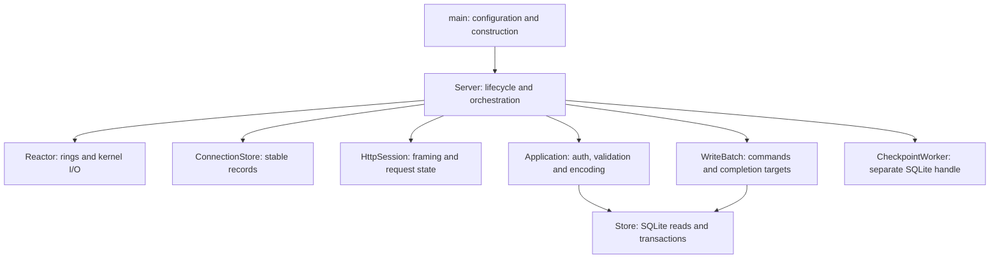

# Server rewrite

Status: phases 1-4 complete; phase 5 (architecture comparison gate) pending

Build a new server around explicit ownership and a typed request pipeline. Replace the current server internals and callback contracts while preserving the API and the algorithms that already proved useful. Compare the result against commit `671fd4e`.

First replace the architecture with the existing scheduling and memory policies. Keep allocation/release points, pool scope and limits, receive copying, ring selection, batch flush rules and wait thresholds unchanged through the comparison gate. Ownership changes may alter object layout; record those differences explicitly. Activate global admission control only in a separate phase after that gate passes.

## Architecture decisions

| Decision | Reason |
| --- | --- |
| C++23 and the current pinned dependencies | Separate the rewrite from compiler and library experiments |
| One event-loop thread and one foreground SQLite owner | Keep ordering and execution local on the one-vCPU target |
| A separate PASSIVE checkpoint worker | Preserve the measured improvement without sharing SQLite handles |
| Concrete components and direct calls | Make dependencies explicit without an event bus, virtual handlers or `std::function` dispatch |
| Small idle connections, pooled active exchanges | Most open connections are waiting between requests |
| One bounded write batch across connections | Preserve group commit without a collection delay |
| Direct descriptors across lazy rings | Preserve capacity above the ordinary process FD limit |

SQLite remains synchronous on the foreground thread. A completion budget does not bound a blocking COMMIT. A database worker is a separate decision if current evidence shows that blocking I/O still prevents network progress.

## Components



| Component | Owns | Boundary |
| --- | --- | --- |
| `Server` | Component lifetimes, dispatch turns and shutdown | Coordinates transitions; contains no SQL, JWT parsing or SQE construction |
| `Reactor` | Rings, listener, accept tickets, wake/stop descriptors and operation bookkeeping | Submits I/O and exposes typed completions; knows no routes or database commands |
| `ConnectionStore` | Stable connection records and embedded operation storage | Allocates and retires records; never moves them while I/O or a batch refers to them |
| `HttpSession` | llhttp parser, framing state, retained input and pipeline remainder | Reports header/message boundaries; performs no auth or database work |
| `Application` | Route preparation, per-request auth, validation and response encoding | Converts HTTP input into closed domain values; maps outcomes to exact API bytes |
| `WriteBatch` | Commands, connection targets and outcome slots, with one count | Resolves each batch once; retains no borrowed parser data |
| `Store` | Foreground SQLite handle, prepared statements, B-tree access and transaction state | Accepts domain values; knows no HTTP statuses, connections or rings |
| `Reply` and buffer pools | Header storage, body lease, send vectors and partial-send offset | Keep submitted memory stable through terminal CQEs |
| `CheckpointWorker` | Its SQLite handle, thread and coalesced wakeup state | Performs checkpoints, never application requests |

`Server` calls these components explicitly. It does not pass a mutable server-wide context through them. Dispatch consumes completions directly through stable operation identities, without allocating event objects or introducing another event queue.

Proposed layout:

```text
src/server/
  main.cpp
  server.hpp / server.cpp
  model.hpp
  net/          reactor, connections, buffers
  http/         session, reply
  app/          application, auth, json
  storage/      database, sqlite_read
  diagnostics/  optional counters and reporting
```

Keep related small types together. These are responsibility boundaries, not a class or file for every helper. Model types depend on neither HTTP nor SQLite/liburing headers.

## Typed boundaries

Use distinct `UserId`, `PostId`, direct-slot and OS-descriptor types. Validate external values once at their boundary. A direct slot must never reach an ordinary-FD API.

```cpp
using ReadQuery = std::variant<Health, Feed, GetPost>;
using WriteCommand = std::variant<CreatePost, LikePost>;
using PreparedRequest = std::variant<ReadQuery, WriteCommand>;

using WriteValue = std::variant<CreatedPost, LikeResult>;
using WriteOutcome = std::expected<WriteValue, WriteError>;
```

`CreatePost` owns its validated body and token username. `LikePost` contains validated IDs. `CreatedPost` owns the generated ID and timestamp. Expected failures are named values, rather than `exception_ptr` or an ambiguous `optional<bool>`.

| Operation | Contract |
| --- | --- |
| `HttpSession::consume(bytes)` | Consumes owned input to a header/message boundary and reports consumed bytes; parser state survives fragments |
| `Application::accept_headers(head)` | Classifies the route and verifies protected requests once; returns an accepted route context or API error |
| `Application::prepare(context, body)` | Produces a fully validated query or owned write command |
| `Application::read(query, reply_body)` | Performs the fresh read and encodes its response |
| `Store::commit(commands, outcomes)` | Takes equally sized caller-owned spans of at most 16 items; preserves input order and reports transaction failure separately from item errors |
| `Application::write_reply(command, outcome, reply_body)` | Encodes a resolved outcome without executing the command again |

Classify route shape before validating an ID. Protected routes check auth before IDs and bodies. Protocol framing checks retain precedence over application validation. A header rejection closes the connection so unread body bytes cannot become another request.

## Read flow

1. Copy a receive lease into session-owned input, then return the lease before application work
2. Parse to the header boundary, prepare the accepted route context, then resume parsing
3. Prepare the complete typed query and create reply storage using the existing allocation policy
4. Read SQLite and encode directly into the reply body; close cursors and the read transaction before scheduling a send
5. Build headers separately and submit the existing scatter-gather send
6. Advance the offset on partial sends; after final completion, release reply storage and process any pipeline remainder

Keep the direct B-tree feed algorithm and SQL point reads. Feed IDs, author lookups and like counts remain request-local. Health still performs its SQLite check.

Storage writes typed field values through a concrete `PostWriter` into caller-owned reply storage. Each SQLite view is consumed before another cursor operation can invalidate it. No cursor view or allocated vector of posts escapes storage.

All JSON details belong to the writer: keys, field order, escaping, separators, envelopes and number formatting. `Store` contains no JSON literals or HTTP formatting, and the writer performs no SQLite work. Test the writer's exact bytes independently, then verify the same bytes through storage integration tests.

The initial rewrite retains the receive copy and current input compaction behavior. Read offsets and direct receive parsing are separate later experiments. The previous direct parsing trial saved memory without improving CPU cost.

## Write flow

`WriteBatch` has a limit of 16 and one authoritative count. Commands own everything needed after parser reset. Preserve the current reserved command vector, fixed target/response slots and per-batch outcome allocation through the architecture comparison. The new typed boundary must not introduce response-index remapping. Fixed outcome storage is a later allocation experiment.

```text
prepare -> enqueue and pin target
        -> flush at 16, end of turn, or before waiting
        -> BEGIN
        -> writes with per-item savepoint isolation
        -> COMMIT
        -> mark batch resolved
        -> encode and schedule replies
        -> release commands and target pins
```

- Collect commands before opening the transaction; add no batching timer
- Keep reads outside the write transaction. Another connection may read committed data while an unacknowledged write is queued
- Preserve batch order and serialize application execution on each HTTP connection
- Preserve current transaction/savepoint execution and the single-item savepoint shortcut; compare prepared control statements separately after the rewrite
- Roll back recoverable item failures to their savepoint; valid items may still commit
- On transaction or COMMIT failure, invalidate provisional successes and resolve rollback before publishing failure
- Mark the batch resolved before reply preparation. Serialization or send failure after COMMIT must never replay a write
- Preserve distinct outcomes for a missing post, new like and duplicate like

Keep WAL/NORMAL and the separate checkpoint handle. Checkpoint failure does not undo an already committed write.

## State and lifetime

```text
Connection: open -> closing -> retired

Exchange: absent -> parsing -> awaiting_commit -> sending -> absent
                         \--------------------> sending
```

A read or error takes the direct path to sending. Fragments remain in parsing. A pipeline tail keeps the exchange alive and returns it to parsing after the previous reply completes. Only one request per connection reaches application execution at a time.

Operation records are authoritative for pending kernel I/O. Exchange phase is authoritative for request progress. Avoid extra booleans that duplicate either state.

| Resource | Safe release point |
| --- | --- |
| Receive buffer | Bytes copied or consumed; return exactly once, including error CQEs carrying a buffer ID |
| Request input/context | No parser view or command borrows it; preserve pipeline remainder |
| Command and target pin | Transaction resolved or command cancelled before execution; reply preparation no longer needs it |
| Reply body, headers, vectors and message | Final send CQE or terminal completion after cancellation |
| Connection and direct slot | Original data operation and close completed; no queued work refers to the record |
| Accept ticket | Terminal CQE received; close late successful accepts during shutdown |

A cancel CQE alone does not retire the cancelled operation. Keep stable records pinned through terminal CQEs; ordinary reuse therefore needs no additional generation-based identity scheme.

## Memory and scheduling during the rewrite

`ConnectionStore` initially preserves the current per-connection allocation and release policy, stable addresses and O(1) free-slot reuse. Keep parser and send state outside it. Phase 3 to 4 layout: Connection stays 56 bytes, Exchange grows from 584 to 608, HttpSession from 424 to 448. Stable pages and connection-object reuse remain later experiments, without changing this ownership boundary.

Keep the current per-ring Exchange limits, receive-pool sizing and response-body release policy. Do not introduce global pooling or retain response bodies during the ownership rewrite. A later body-reuse experiment must account for the existing 8-KiB Exchange retention policy separately from reply storage.

```text
userspace memory ~= connections * sizeof(Connection)
                  + live and pooled exchanges
                  + owned input/output capacities
                  + ring receive/queue storage
                  + SQLite caches and allocator overhead
```

Kernel sockets and file cache also count against the deployment limit. Record aggregate memory across rings, without changing allocation or admission decisions in this phase.

A dispatch turn starts with the current measured defaults:

1. Service rings fairly, up to 256 CQEs per ring, with bounded deferred-receive retries
2. Run reads inline; enqueue writes and flush when the batch reaches 16
3. Flush the partial batch at the end of the turn and submit prepared sends
4. Wait only after ready work and required submissions have been handled

Keep 64 pending accepts, up to 16 lazy rings, the existing ring selection, official per-ring descriptor-table limit and current busy-wait batching policy. Do not tune these while validating the architecture.

## Global admission control, after the rewrite

Introduce byte-budget accounting and high/low watermarks as a separate change against the accepted rewrite. Keep pool sizing, scheduling and buffer-reuse policies unchanged in this experiment. Admission control may pause new request work, but completing admitted work must never require admission of another request.

Reserve progress capacity for partial requests and outstanding replies. Acquire response storage before opening a SQLite transaction. Deferred receives retain bytes in bounded leases. Give existing work a path to release memory even when new work is paused; never wait for budget while holding a transaction.

Exhaustion tests are a hard adoption gate. Use deliberately small budgets and real io_uring lifecycle coverage to force these cases:

- All receive leases are held while slow sends consume output capacity; once a send can complete, replies and deferred receives resume without admitting new work
- Partial requests need more input while the high watermark is active; reserved progress capacity allows them to finish
- A full write batch reaches the memory limit; it can resolve and publish replies without holding a transaction while waiting for storage
- Cancellation, disconnect and shutdown occur at exhaustion; terminal CQEs return every lease and budget credit exactly once
- Crossing the low watermark resumes paused work without lost wakeups, unbounded queues or busy spinning

Assert bounded progress after blocked resources become available, correct responses and complete resource retirement. Do not enable or adopt the policy if any case fails. Only after these tests pass, compare it against the accepted rewrite with identical workload and generator settings. Pool/slab changes remain separate experiments.

## Errors and shutdown

Use typed results for malformed input, missing data, constraint failures and transaction failure. Map errors to HTTP in the application. Fail early where protocol/error precedence permits it.

Unexpected request failure fails or closes that connection without corrupting unrelated work. If SQLite cannot return to a known transaction state, stop database admission and shut down. Unrecoverable ring failure stops the server.

Shutdown follows dependency order:

1. Stop accepts and application dispatch; cancel accept tickets and handle late successes
2. Cancel queued writes that have not begun, without success responses, matching current shutdown behavior; resolve any transaction already executing
3. Finish or cancel sends/receives, drain terminal CQEs and close direct slots
4. Release exchanges and connections only after their dependencies retire
5. Stop and join the checkpoint worker, close SQLite handles, then destroy ring resources

## Replacement plan

| Phase | Deliverable | Acceptance |
| --- | --- | --- |
| 1. Contracts and storage (done) | Domain values, explicit errors and caller-owned read output; migrate B-tree and group-commit internals without allocation or transaction-policy changes | Release and diagnostic builds pass; writer bytes, rollback/checkpoint checks, 42 official checks and 17 HTTP regressions pass |
| 2. I/O and lifetime core (done) | Reactor, connection ownership, buffer leases, direct accepts and cancellation/close handling; existing allocation, pool and scheduling policies retained | Release/diagnostic builds, 42 official checks and 17 HTTP regressions pass; native and ASan/UBSan tests cover 70,000 connections under the 65,535 server FD limit, slot reuse, exhaustion, partial I/O, original-CQE lifetime and late-accept shutdown |
| 3. HTTP and application (done) | Session state machine, header acceptance, typed preparation and reply ownership; Application component-tested before production wiring in phase 4 | Release/diagnostic builds, 5 Application test groups, ASan/UBSan transport checks, 42 official checks and 17 HTTP regressions pass |
| 4. Direct cutover (done) | Concrete Server/Application/HttpSession/Reactor path; old contracts removed | Release/diagnostic builds, native and ASan/UBSan transport checks, 42 official checks and 17 HTTP regressions pass; 300k/60s hold completes without errors |
| 5. Architecture comparison gate | Optimized normal build against `671fd4e`, with identical scheduling, allocation/pool policies, generator build, source-IP count, workload settings and fresh seed database | Focused checks pass; inspect changed hotpaths in disassembly and compare a short profile, then confirm at 300k; reject unexplained CPU, memory or tail-latency regressions before proceeding |
| 6. Admission control | Add and activate global byte budgets and high/low watermarks separately; preserve pool sizing and scheduling | Every admission-exhaustion test above passes before adoption; compare against the accepted rewrite and retain `671fd4e` as the overall reference |

Keep the old implementation in Git, without a permanent adapter, runtime switch or v2 API. Tests can exercise replacement components before cutover. Reuse proven algorithms without inheriting old ownership contracts.

The split 500k run is a separate unresolved tooling problem: both generators stalled through the hold, so it cannot establish server capacity. Resolve it before using 500k as an acceptance gate. It does not block the rewrite's component tests.

Extra database workers, multishot receive, SIMD/assembly and compiler experiments stay separate. No caching, schema/index changes or kernel tuning. Implementation stays under `src/`, with strict typing, related code grouped together, early exits and no terminal periods in comments.

A required change to the agreed ownership, concurrency or API behavior returns to planning.
