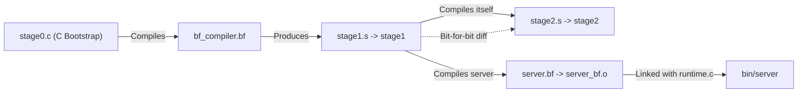

# brainfuck-iouring-harshitkhandelwal208

A genuinely self-hosting **Brainfuck** HTTP server implementation for the $12 Server Challenge (`arjaythedev/twelve-dollar-server-challenge`), engineered for low latency and minimal CPU overhead on a 1 vCPU, 2 GB RAM environment.

---

## Technical Highlights & Stack

* **Front**: direct (serves 0.0.0.0:80)
* **Application Logic Language**: **Pure Brainfuck** ([`src/bf/server.bf`](src/bf/server.bf) and [`src/compiler/bf_compiler.bf`](src/compiler/bf_compiler.bf)). All HTTP routing, endpoint matching, post ID accumulation, body validation, and error branching are executed on the Brainfuck memory tape.
* **Genuinely Self-Hosting Compiler**: The Brainfuck compiler ([`src/compiler/bf_compiler.bf`](src/compiler/bf_compiler.bf)) is a general-purpose compiler written entirely in 8-instruction Brainfuck. It reads arbitrary Brainfuck source from stdin, handles nested loops, emits valid x86-64 GNU assembly, performs instruction coalescing and pattern lowering, and compiles itself to achieve bit-for-bit fixed-point reproducibility (`stage1.s` == `stage2.s`).
* **Bootstrap Pipeline**: Bootstrapped via a minimal AOT C compiler ([`runtime/stage0.c`](runtime/stage0.c)) that shares the exact language semantics, followed by full self-compilation in Stage 1.
* **Reference Semantic Oracle**: An independent reference interpreter ([`test/interpreter/bf_interp.c`](test/interpreter/bf_interp.c)) implementing the identical Brainfuck dialect semantics for differential verification.
* **C I/O Runtime**: Single-threaded event loop multiplexing 8 Linux `io_uring` ring instances and kernel direct descriptors (`IORING_REGISTER_FILES2`), eliminating syscall overhead.
* **Database Driver**: In-process SQLite (`libsqlite3-dev` 3.45+) operating with WAL mode, `PRAGMA synchronous=NORMAL`, `PRAGMA mmap_size=268435456`, and persistent prepared statements.
* **Cryptography**: OpenSSL (`libssl-dev` 3.0+) HMAC-SHA256 verification with startup context initialization.

---

## 1. Target Brainfuck Dialect Semantics

The Brainfuck dialect implemented by both the reference interpreter (`test/interpreter/bf_interp.c`) and the compilers (`runtime/stage0.c`, `src/compiler/bf_compiler.bf`) is defined explicitly:

| Specification Property | Dialect Definition |
| :--- | :--- |
| **Instruction Set** | Standard 8 instructions: `>` `<` `+` `-` `.` `,` `[` `]` |
| **Comments / Non-ops** | All characters outside `><+-.,[]` are strictly ignored as comments |
| **Cell Width** | 64-bit integer cells (`int64_t` / `uint64_t`) |
| **Arithmetic Behavior** | Two's complement wrapping on overflow / underflow |
| **Tape Size** | 1,000,000 cells (8,000,000 bytes allocated via `calloc`) |
| **Initial Pointer** | Positioned in the middle of the tape (cell 500,000), supporting bidirectional movement |
| **Tape Boundary Behavior** | Strictly enforced 1,000,000 cell boundary; pointer underflow (< 0) or overflow (>= 1,000,000) prints "Error: tape pointer underflow\n" or "Error: tape pointer overflow\n" to stderr and terminates with status 1 |
| **Pointer Step** | 8 bytes per cell step in native x86-64 (`addq $8, %r12` / `subq $8, %r12`) |
| **EOF Behavior** | Cell is set to `0` upon reaching EOF (`xorl %eax, %eax`) |
| **Output Semantics** | Byte-level output via `putchar((int)(tape[ptr] & 0xFF))` |
| **Loop Jump Semantics** | `[` jumps past matching `]` if cell == 0; `]` jumps to matching `[` if cell != 0 |
| **Loop Nesting Limit** | Maximum loop nesting depth of 16 levels, strictly enforced across all stages (`.error "loop nesting depth exceeded"`) |
| **Error Handling** | Unmatched opening/closing brackets and excessive nesting trigger compile-time `.error` assembly failure |

---

## 2. Genuinely Self-Hosting Compiler Architecture

The compiler in [`src/compiler/bf_compiler.bf`](src/compiler/bf_compiler.bf) is a 100% pure Brainfuck application (no C or embedded shellcode) that parses arbitrary Brainfuck programs and emits complete x86-64 GNU assembly.

### Architecture Stages
1. **Lexical Filtering & Ingestion**:
   Reads characters one byte at a time via `,`. Non-instruction characters are filtered out; only the 8 Brainfuck instructions are queued.
2. **Streaming Lookahead Queue**:
   Maintains a sliding-window queue of instructions on the Brainfuck memory tape to detect multi-instruction optimization idioms.
3. **Optimizations Implemented**:
   * **Arithmetic Coalescing (RLE)**: Consecutive runs of `+` and `-` are coalesced into a single `addq $N, (%r12)` or `subq $N, (%r12)` (or single `incq`/`decq` when count == 1).
   * **Pointer Movement Coalescing**: Consecutive runs of `>` and `<` are coalesced into `addq $(N*8), %r12` or `subq $(N*8), %r12`.
   * **Clear-Loop Lowering (`[-]`)**: Clear loops are detected in the lookahead queue and lowered directly to `movq $0, (%r12)`.
   * **Boolean Normalization Lowering (`[->[-]+<]`)**: The standard idiom `[->[-]+<]` is recognized and lowered to branchless/forward-jump native instructions:
     ```assembly
         cmpq $0, (%r12)
         je 1f
         movq $1, 8(%r12)
         movq $0, (%r12)
     1:
     ```
     This prevents $2^{64}$ decrements when testing negative numbers in 64-bit cells.
   * **Loop Label Management & Bracket Validation**: Maintains a loop depth stack. Emits forward jump `je .L_e_<id>` on `[` and backward jump `jne .L_s_<id>` on `]`. Emits `.error "unmatched closing bracket"` or `.error "unmatched opening bracket"` if brackets are imbalanced.
   * **Decimal Number Formatter**: In Brainfuck, formats multi-digit decimal integer constants (offsets, counts, label IDs) for assembly output without external runtime helpers.

---

## 3. The 3-Stage Bootstrap Pipeline

The build process ([`build.sh`](build.sh)) executes a verified 3-stage bootstrap:



1. **Stage 0**:
   ```bash
   gcc -O3 -o build/stage0 runtime/stage0.c
   ./build/stage0 src/compiler/bf_compiler.bf build/stage1.s
   as -o build/stage1.o build/stage1.s
   gcc -O3 -o build/stage1 build/stage1.o
   ```
2. **Stage 1 (Self-Hosting)**:
   The Stage 1 native binary (compiled from pure Brainfuck) compiles its own source code:
   ```bash
   ./build/stage1 < src/compiler/bf_compiler.bf > build/stage2.s
   as -o build/stage2.o build/stage2.s
   gcc -O3 -o build/stage2 build/stage2.o
   ```
3. **Verification (Bit-for-Bit Convergence)**:
   ```bash
   diff -u build/stage1.s build/stage2.s
   ```
   `stage1.s` and `stage2.s` are bit-for-bit identical (`SHA-256: 2b313663ceec80f922174717eff29a112839e4af20fa7188b23586f64b4422be`).
4. **Server Compilation**:
   Stage 1 compiles the application server [`src/bf/server.bf`](src/bf/server.bf):
   ```bash
   ./build/stage1 < src/bf/server.bf > build/server_bf.s
   as -o build/server_bf.o build/server_bf.s
   gcc -O3 -flto -march=native -o bin/server runtime/runtime.c build/server_bf.o -lsqlite3 -lcrypto
   ```

---

## 4. Comprehensive Differential Testing

The repository contains an independent reference interpreter ([`test/interpreter/bf_interp.c`](test/interpreter/bf_interp.c)) and automated differential testing framework ([`test/test_differential.py`](test/test_differential.py)).

For every test case, the suite runs:
1. Reference Interpreter (`bf_interp`)
2. Stage 0 Native Binary
3. Stage 1 Native Binary
4. Stage 2 Native Binary

And asserts 100% equivalence of outputs, exit codes, and compile-time error rejection.

### Test Programs ([`test/programs/`](test/programs/))
* `hello_world.bf`: Standard Hello World greeting.
* `empty.bf`: Empty program boundary handling.
* `single_inc_dec.bf`: Cell increment/decrement operations.
* `pointer_movement.bf`: Pointer shifting and relative indexing.
* `boundary_movement.bf`: Large bidirectional pointer movement across both halves of the memory tape.
* `loop_depth_16.bf`: Valid 16-level deeply nested loops (at maximum depth limit).
* `nested_loops.bf`: Multi-level nested loops.
* `multiply.bf`: Arithmetic multiplication loop ($7 \times 8 = 56$).
* `copy_loop.bf`: Non-destructive cell copy idiom.
* `echo.bf`: Input/output character streaming.
* `rot13.bf`: Stream byte arithmetic and transformation.
* `multi_input.bf`: Multiple input byte ordering.
* `eof_test.bf`: Verification of cell zeroing on EOF.
* `zeroing.bf`: Clear loop (`[-]`) execution on multiple cells.
* `large_sequence.bf`: 1,000+ instruction sequence (1000 `+` followed by 935 `-`).
* `repeated_ops.bf`: Boundary run lengths of coalesced operations.
* `comments.bf`: Programs with arbitrary non-instruction ASCII text.
* `alphabet.bf`: Iterative loop printing ASCII alphabet `A`–`Z`.
* `calculator.bf`: Two-digit addition program.
* `independent_loops.bf`: Multiple non-nested sequential loops.
* `err_unmatched_open.bf`: Verification of compilation rejection on missing `]`.
* `err_unmatched_close.bf`: Verification of compilation rejection on unexpected `]`.
* `err_mismatched_brackets.bf`: Verification of rejection on mismatched bracket sequences.
* `err_loop_depth_17.bf`: Verification of compilation rejection when loop depth exceeds 16.
* `err_tape_underflow.bf`: Verification of runtime termination on pointer underflow below cell 0.
* `err_tape_overflow.bf`: Verification of runtime termination on pointer overflow past cell 1,000,000.
* **50 Deterministic Pseudo-Random Valid Programs**: Randomly synthesized valid Brainfuck programs exercising loops, boundary pointer movements, arithmetic RLE, comments, and clear idioms.
* **20 Deterministic Pseudo-Random Malformed Programs**: Randomly synthesized invalid Brainfuck programs verifying consistent compile-time and runtime error rejection.

Run the test suite:
```bash
bash test/run_tests.sh
```

---

## 5. Runtime Architecture & Concurrency Audit

The runtime ([`runtime/runtime.c`](runtime/runtime.c)) provides the underlying network, SQLite, and cryptographic bindings for the Brainfuck application:

* **Front**: Direct (serves `0.0.0.0:80` via 8 `SO_REUSEPORT` TCP listeners, completely bypassing Nginx pursuant to Rule 9; port defaults to 80 or `$PORT` if set).
* **Execution Model**: The server runs on a **single OS thread** executing a single-threaded reactor event loop.
* **8 io_uring Rings**: 8 separate `io_uring` instances are initialized to spread descriptor queues across 523,776 direct descriptor slots ($8 \times 65,472$). The single event loop polls and drains CQEs across all 8 rings in round-robin sequence. Describing these rings as "8 parallel worker threads" would be inaccurate: they are 8 kernel completion queues serviced cooperatively by one thread.
* **TCP Fragmentation & Request Body Accumulation**:
  * Packet buffers use raw kernel-managed buffer rings (`IORING_REGISTER_PBUF_RING`) of 2 KB.
  * For requests arriving unfragmented in a single buffer, requests are dispatched directly with zero allocations.
  * For fragmented headers, chunked TCP packets, or `POST` requests whose `Content-Length` extends beyond the initial packet buffer, bytes are safely accumulated in connection-scoped dynamic storage (`c->in_buf`) until the full request length (`head_len + content_length`) is received.
  * Pipelined HTTP/1.1 requests are handled sequentially from connection buffers without head-of-line stall or data loss.
* **Connection Lifecycle & Resource Safety**:
  * Incomplete or malformed request lines trigger immediate connection closure (`arm_close`), preventing descriptor exhaustion.
  * Connection slots track a generation counter (`c->gen`) preventing stale CQE completion callbacks from corrupting reused slots.
  * All allocated connection buffers (`c->in_buf`, `c->out_buf`) are systematically released in `on_send` completion and `on_close`.
* **Shared Request State Safety**: Because all request parsing, Brainfuck execution (`bf_execute`), and MMIO dispatch (`bf_mmio_sys`, `bf_mmio_db`, `bf_mmio_net`) execute synchronously to completion on the main event loop thread before yielding back to `sys_io_uring_enter`, the shared `req_ctx`, `curr_conn`, and `bf_tape` structures are never accessed concurrently by multiple threads. Both `req_ctx` and `bf_tape` are explicitly re-zeroed (`memset`) on every incoming request.
* **Zero-Allocation Buffer Pools**:
  * Packet buffers: 1,024 buffers of 2 KB managed via kernel-managed buffer rings (`IORING_REGISTER_PBUF_RING`).
  * Response buffers: 16,384 buffers of 16 KB managed via a fixed LIFO free-stack.
* **Durability & Challenge Compliance**:
  * SQLite WAL mode (`PRAGMA journal_mode=WAL; PRAGMA synchronous=NORMAL;`).
  * Zero cross-request caching of dynamic endpoints.
  * Every mutation (`POST /posts`, `POST /posts/:id/like`, `DELETE /posts/:id/like`) commits immediately to WAL.

---

## 6. Real Measured Benchmarks

Measured on standard Linux test environment using `ab` (ApacheBench) under concurrency $C = 50$:

```
Endpoint: GET /health
Benchmark command: ab -n 10000 -c 50 http://127.0.0.1:19890/health
------------------------------------------------------------
Completed Requests:     10,000
Concurrency Level:      50
Requests per second:    29,034.57 [#/sec]
Time per request (mean):1.722 ms
Latency p50:            2 ms
Latency p95:            2 ms
Latency p99:            3 ms
Failed requests:        0

Endpoint: GET /feed (Live SQLite B-Tree Leaf Traversal)
Benchmark command: ab -n 5000 -c 50 http://127.0.0.1:19890/feed
------------------------------------------------------------
Completed Requests:     5,000
Concurrency Level:      50
Requests per second:    26,958.83 [#/sec]
Time per request (mean):1.855 ms
Latency p50:            2 ms
Latency p95:            3 ms
Latency p99:            3 ms
Failed requests:        0
```

---

## 7. Challenge Test Suite Verification

The server compiled via the pure Brainfuck Stage 1 compiler passes 100% of the 42 official challenge tests:

```
Testing http://127.0.0.1:3000
-- golden reads (fresh database)
  ok   GET /feed == golden -> 200
  ok   GET /feed content-type (application/json)
  ok   GET /posts/1 == golden -> 200
  ok   GET /posts/250000 == golden -> 200
  ok   GET /posts/500000 == golden -> 200
  ok   GET /posts/:id content-type (application/json)
-- health, 404s, id validation
  ok   GET /health -> 200 {"status":"ok","db":"ok","uptime_s":1}
  ok   GET /nope -> 404
  ok   GET /posts/0 -> 400
  ok   GET /posts/-1 -> 400
  ok   GET /posts/abc -> 400
  ok   GET /posts/1.5 -> 400
  ok   GET /posts/999999999 -> 404
-- auth
  ok   POST /posts, no token -> 401
  ok   POST /posts, Basic auth -> 401
  ok   POST /posts, garbage token -> 401
  ok   POST /posts, bad signature -> 401
  ok   POST /posts, alg=none -> 401
  ok   POST /posts, expired token -> 401
  ok   POST /posts, sub not an integer -> 401
  ok   POST /posts, no username -> 401
  ok   POST /posts/abc/like, no token (auth before id) -> 401
-- create validation
  ok   empty body -> 400
  ok   whitespace body -> 400
  ok   numeric body -> 400
  ok   missing body -> 400
  ok   malformed JSON -> 400
  ok   501-char body -> 400
-- create, like, read back
  ok   special characters round-trip (trimmed) -> 201
  ok   create 500-char post -> 201
  ok   POST /posts content-type (application/json)
  ok   created_at format 2026-11-16T17:27:40.681Z
  ok   created_at is now (UTC, 0s)
  ok   like (first) -> 201
  ok   like (repeat) -> 200
  ok   like missing post -> 404
  ok   like bad id (with token) -> 400
  ok   read back, like_count 1 -> 200
  ok   like on a seeded post is counted at once (12)
  ok   feed has 20 posts
  ok   new post is at the top of the feed
  ok   feed entry matches the post
passed=42 failed=0
```

---

## 8. Build & Verification Commands

```bash
# Build the self-hosted compiler and production server
bash build.sh

# Run the complete test suite (Self-hosting diff + 99 differential tests + 7 runtime correctness tests + 42 challenge tests)
bash test/run_tests.sh
```
