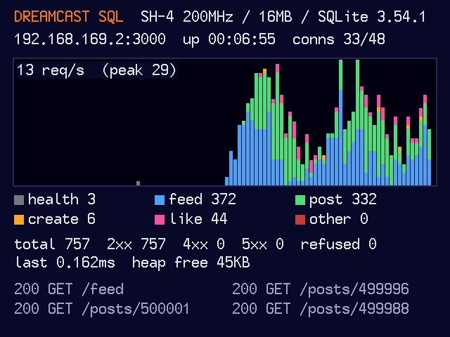

# C on a Sega Dreamcast (KallistiOS + SQLite, in Flycast)

**This is a joke entry.** The whole server, from the HTTP parser to the SQLite B-tree, runs as a
KallistiOS program on an emulated Sega Dreamcast: a 200 MHz Hitachi SH-4 with 16 MB of RAM, talking
to the world through an emulated Broadband Adapter. It passes all 42 checks. It is not fast.

- **Language:** C (gcc 13.2.0, `sh-elf`, `-m4-single`)
- **Framework:** none; KallistiOS 2.2.2 (the Dreamcast homebrew OS) for threads, TCP/IP and the BBA driver
- **Driver:** SQLite 3.54.1 amalgamation, compiled for the SH-4, with a custom VFS
- **Emulator:** Flycast `1b63c8a`, built from source with a small patch, HLE BIOS (no Sega BIOS)
- **Nginx or direct:** **behind Nginx**. 16 MB of RAM holds 48 connections, not 15,000.

While it runs, the Dreamcast's video output shows a live dashboard: requests per second for the last
100 seconds stacked by endpoint, per-endpoint and per-status counters, the last few requests, the
latency of the last one and the free heap. On the scoring box it draws into an Xvfb nobody looks at;
locally, run with a display (or `DREAMCAST_SCREEN=1`) to watch it.

## How it fits together

```
k6 ─► Nginx ─► 127.0.0.1:$PORT ─► Flycast (host process)
                                    │ asio acceptor → picoTCP → emulated RTL8139 BBA
                                    ▼
                   ┌──── emulated Dreamcast (SH-4, 16 MB) ─────────────┐
                   │ KallistiOS TCP/IP ─► guest/main.c (poll loop)      │
                   │   fbparse.h (HTTP) · cursed-jwt (HS256) · api.c    │
                   │   SQLite 3.54.1 ─► guest/vfs_hostfs.c              │
                   └──────────────────────────│────────────────────────┘
                                              │ "BIOS" syscall at 0x8C00100A
                                    Flycast reios/hostfs.cpp: pread/pwrite/fsync
                                              ▼
                                        $SQLITE_PATH (+ -wal)
```

- **Networking.** Flycast already NATs the emulated Broadband Adapter through picoTCP and can forward
  inbound TCP ports, but only for a hard-coded list of games. Our patch adds `FLYCAST_TCP_FORWARD` /
  `FLYCAST_TCP_BIND`, so `$HOST:$PORT` on the host is forwarded to port `$PORT` on the Dreamcast
  (192.168.169.2, from picoTCP's DHCP). Local clients appear to the guest as 198.18.0.1, because
  KallistiOS would answer 127.0.0.1 on its own loopback.
- **The database file.** SQLite runs inside the Dreamcast (rules 1–3), so its page I/O has to reach
  the real `$SQLITE_PATH`. The patch adds a syscall to Flycast's HLE BIOS: the guest's SQLite VFS calls
  it to `pread`, `pwrite`, `fsync`, truncate and stat `$SQLITE_PATH` and its `-wal` file, so the file
  on the host is the database. The VFS has no shared memory, which SQLite allows for WAL only in
  `locking_mode=EXCLUSIVE`; the WAL index lives in the guest heap. `journal_mode=WAL`,
  `synchronous=NORMAL` (rule 6): every commit is written through to the host's `-wal` before the 201,
  and `xSync` is a real host `fsync` at checkpoints.
- **No caching** (rule 5): every request runs its query; only the prepared statements persist.
  SQLite's page cache is 3 MB of the 16.
- **Per request.** One KallistiOS thread polls the listening socket and up to 48 connections. Past 48
  it accepts and closes at once, rather than run out of RAM. `/feed` and `/posts/:id` are the queries
  from SPEC.md; `POST /posts` uses `INSERT ... RETURNING`; likes use `ON CONFLICT DO NOTHING`.
- **Clock.** `created_at` comes from SQLite's `strftime('%f')`, and the VFS gets the host's clock
  through the same syscall, so timestamps are real UTC with milliseconds. JWT `exp` uses it too.
- **KallistiOS patch.** Its TCP sent a passive close (the client's FIN first) through CLOSING and
  TIME_WAIT, keeping each socket and its 16 KB of buffers for 30 s. With a new connection per request
  that filled 16 MB in about 900 requests. One line sends it to LAST_ACK, as RFC 793 says.
- **Reboots.** Flycast occasionally crashes on the host under heavy connection churn (a double free
  or a segfault after a few hundred to a few thousand new connections; AddressSanitizer did not catch
  it and we have not found the cause). `start.sh` reboots the Dreamcast when that
  happens, in about a second. Committed rows are already in the host file, so a reboot loses only the
  requests in flight. A watchdog in `start.sh` does the same if `/health` stops answering for
  about 30 s.

## Build

`install.sh` (root, once) installs the host compiler, CMake/Ninja, SDL2/Mesa, Xvfb and the
toolchain's build deps. `build.sh` builds everything from source into `build/`:

1. SQLite 3.54.1 amalgamation (sha256-checked)
2. KallistiOS 2.2.2 tarball (sha256-checked) + `patches/kos/`
3. the `sh-elf` cross toolchain (GCC 13.2.0, binutils 2.43, newlib 4.3) with KallistiOS's `dc-chain`.
   **This is slow: expect well over an hour on one vCPU.**
4. KallistiOS
5. Flycast at `1b63c8a` with the submodules it needs, + `patches/flycast/`
6. `guest/` → `build/dreamcast-sql.elf`

Nothing prebuilt is shipped: KallistiOS's prebuilt ARM7 sound driver is replaced by an empty file,
since nothing plays sound. Licences are in [THIRD_PARTY.md](THIRD_PARTY.md).

## Run and test

```bash
bash test/run.sh submissions/c-dreamcast-public   # from the challenge repo
```

`start.sh` writes a throwaway Flycast config (HLE BIOS, Broadband Adapter, no audio, no online
services), starts its own Xvfb when there's no `$DISPLAY`, and runs Flycast in the foreground. The
server answers `/health` a few seconds after `start.sh`.

## Numbers



*The Dreamcast's screen during the k6 run below: requests per second for the last 100 seconds by
endpoint (blue `/feed`, green `/posts/:id`, pink likes, orange creates), 33 of 48 connection slots in use.*

Measured locally in Docker on an Apple-silicon Mac (arm64 Linux, so Flycast's arm64 dynarec, not the
scoring box's x86-64 one), behind the challenge's `bench/nginx.conf`, with its own k6 script:

```bash
k6 run -e BASE_URL=http://127.0.0.1 -e VUS=150 -e RAMP_UP=10s -e DURATION=50s bench/load.js
```

| VUs | requests/s | median | p95 | p99 | errors |
|---|---|---|---|---|---|
| 150 | 10.3 | 12 ms | 2.02 s | 2.05 s | 0.29 % |

So it **fails the latency thresholds at 150 users**, well under the 2,500 the scoring starts at. The
2-second tail is KallistiOS's TCP retransmission timeout: some frames between picoTCP and the emulated
Broadband Adapter get dropped, and the guest waits 2 s to resend. A single client sending one request at
a time gets about 40–80 requests/s.

**Known problems**, still being investigated: after the 150-VU run above, the guest stopped answering
with 34 connections open (the `/health` watchdog in `start.sh` reboots it within about a minute), and
Flycast itself occasionally crashes on the host under heavy connection churn (see Reboots above).

## Files

| | |
|---|---|
| `guest/main.c` | the poll loop, HTTP framing and the framebuffer dashboard |
| `guest/api.c` | the five endpoints: SQL, request JSON parser, JSON output |
| `guest/vfs_hostfs.c`, `guest/hostfs.h` | the SQLite VFS and the guest side of the syscall |
| `guest/third_party/` | cursed-jwt and cursed-http-parser (ours, MIT) |
| `patches/flycast/` | hostfs syscall + TCP forwarding (GPL-2.0, as part of Flycast) |
| `patches/kos/` | the TCP LAST_ACK fix |
