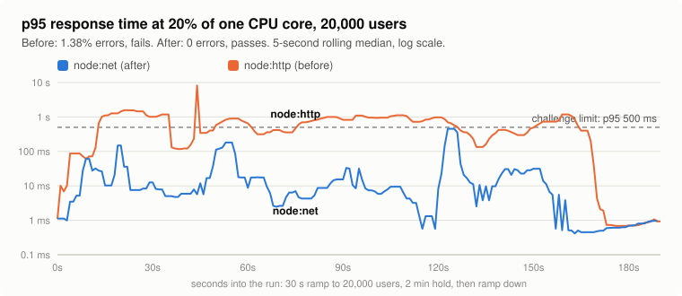
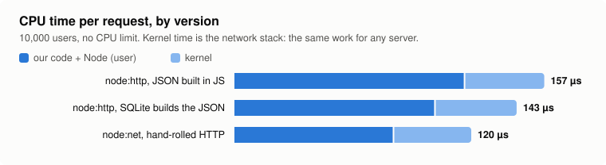
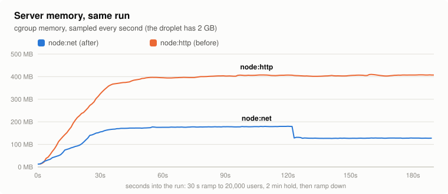

# Node.js, no framework

- **Language/runtime:** Node.js v24.21.0 (official tarball)
- **Framework:** none. HTTP/1.1 is parsed by hand on `node:net` sockets, with a hand-rolled router
- **SQLite driver:** `node:sqlite` (built into Node, `DatabaseSync`)
- **JWT:** hand-rolled HS256 check with `node:crypto` (`createHmac` + `timingSafeEqual`)
- **Dependencies:** zero. No `package.json`, no `node_modules`
- **Nginx or direct:** direct (`0.0.0.0:80`). Node holds the ~15k idle keep-alive connections cheaply, so we skip the CPU Nginx would take

## Optimizations

In the order we made them. Each one was measured before and after (see [Measurements](#measurements)).

1. **Prepared statements, sensible PRAGMAs.** Every statement is prepared once at startup and reused.
   WAL, `synchronous=NORMAL`, 64 MB page cache, 256 MB `mmap`, `temp_store=MEMORY`.
2. **One statement per like.** `INSERT INTO likes ... SELECT ?, id FROM posts WHERE id = ? ON CONFLICT DO NOTHING`
   inserts only when the post exists. The extra existence check runs only when nothing was inserted
   (already liked, or no such post), to tell 200 from 404.
3. **Rows as arrays.** Statements return rows as arrays (`setReturnArrays`, Node 24), not objects.
4. **SQLite builds the read responses.** `GET /feed` and `GET /posts/:id` select one string, built with
   `json_object` / `json_group_array` (keys in the spec's order), so one string crosses into JS instead of
   20 row objects that JS then serializes. The bytes are identical to the old output (checked against the
   golden files and 20,000 random posts).
5. **No `node:http`.** Once SQLite was fast, most CPU went to Node's HTTP layer (request/response
   objects, streams, events). The server reads raw bytes from each TCP socket, parses the request line
   and the few headers it needs (`Content-Length`, `Authorization`, `Connection`, `Expect`), and writes
   each response as one string. Pipelined requests are answered in order, in one write.
6. **Long keep-alive.** Idle connections are kept for 70 s, longer than any k6 think time, so users keep
   their connection instead of reconnecting.

### The HTTP layer

It speaks keep-alive, pipelining, HTTP/1.0, `Connection: close` and `Expect: 100-continue`, and sends a
`Date` header. Malformed requests get a 400, headers over 8 KB a 431, bodies over 64 KB a 413, and the
connection is closed. Chunked request bodies get a 411: clients send `Content-Length` for small JSON
bodies. Besides `test/test.sh`, it was tested with raw sockets: requests split into single bytes, bodies
split across packets, many requests in one packet, and a client that sends without ever reading.

## Measurements

Same load, same squeezed CPU: the `node:http` version spends the run above the challenge's 500 ms limit and
drops 1.38% of requests. The `node:net` version stays mostly between 1 and 50 ms, with no errors.

These numbers come from a dev box, not the droplet, so compare them with each other, not with other
submissions. The server ran in a cgroup like a small VM: pinned to one core of a Ryzen desktop, with a
CPU quota, 2 GB memory cap and no swap. k6 ran `bench/load.js` on the other cores, never on the server
core's hyperthread sibling. Each run was a 30 s ramp and a 1 minute hold.

**CPU per request** is the cgroup's CPU time (user + kernel) divided by requests served, so it counts
the kernel's network work too. It's the number we trusted most: the V8 profiler leaves out kernel time
and gets skewed when the CPU is throttled.

### CPU and memory per version (10,000 users, no CPU limit)

| Version | CPU per request | user | kernel | Memory peak |
|---|---:|---:|---:|---:|
| `node:http`, rows as objects, JSON built in JS | 157 µs | 117 µs | 40 µs | |
| `node:http`, SQLite builds the JSON (4) | 143 µs | 102 µs | 41 µs | 255 MB |
| **`node:net`, hand-rolled HTTP (5)** | **120 µs** | **81 µs** | **39 µs** | **113 MB** |

Kernel time barely moves: that's the network stack, the same work for any server. Everything we
gained came out of user space, where the per-request JS work went from 117 µs to 81 µs (−31%).

### Squeezing the CPU (20,000 users)

The quota is a share of one core. Fewer cores' worth of CPU for the same 20,000 users shows how much
headroom is left. "Pass" is the challenge's bar: p95 < 500 ms, p99 < 1 s, errors < 1%.

| Version | Quota | p95 | p99 | Errors | CPU per request | Memory peak | Result |
|---|---|---:|---:|---:|---:|---:|---|
| `node:http`, JSON in JS | 25% | 266 ms | 444 ms | 0% | | | pass, near its limit |
| `node:http`, SQLite JSON | 25% | 45 ms | 404 ms | 0% | 115 µs | 471 MB | pass |
| **`node:net`** | **25%** | **0.7 ms** | **10 ms** | **0%** | **94 µs** | **179 MB** | **pass** |
| `node:http`, SQLite JSON | 20% | 1.17 s | 2.76 s | 1.72% | 123 µs | 467 MB | **fail** |
| **`node:net`** | **20%** | **50 ms** | **205 ms** | **0%** | **97 µs** | **187 MB** | **pass** |
| `node:http`, SQLite JSON, 2 min hold (charts) | 20% | 1.08 s | 1.54 s | 1.38% | 116 µs | 460 MB | **fail** |
| **`node:net`, 2 min hold (charts)** | **20%** | **110 ms** | **462 ms** | **0%** | **92 µs** | **187 MB** | **pass** |

The charts come from the two 2-minute runs. In the same time, the `node:net` version also served 10%
more requests (333,520 against 301,842), because its users weren't stuck waiting.

Near the limit, latency jumps sharply and varies from run to run (an earlier run of the SQLite JSON
version at 25% got p95 8.7 ms). Read the pass/fail columns and CPU per request; the latencies only show
which side of the knee a run was on.

### Read paths in isolation

A V8 CPU profile of the first version pointed at the feed query first, then Node's HTTP layer. We don't
publish profile numbers: with the server on one throttled core, the profiler double-counts time when the
CPU is saturated and misses most of it when it isn't, so two versions can't be compared fairly. CPU per
request (above) is the comparison.

Timing the read paths in isolation (Node 24, same data):

| | Rows as objects, JSON in JS | Rows as arrays, JSON in JS | SQLite builds the JSON |
|---|---:|---:|---:|
| `GET /feed` | 31.9 µs | 21.6 µs | ~22 µs |
| `GET /posts/:id` | 6.1 µs | | 4.8 µs |

Arrays and SQLite-built JSON cost about the same here, but SQLite-built JSON leaves no objects behind
for the garbage collector, which showed up under load.

## Ideas we didn't use

- **Coalescing reads** (one feed query shared by every request in a 100 ms window). That's a
  query-result cache, which rule 5 forbids, and it adds up to 100 ms of latency. After optimization 4
  the feed query is only ~10 µs of a request anyway.
- **Group commit for writes.** Allowed by rule 6, but likes and new posts are under 10% of requests,
  so it would save a couple of percent at most.
- **Nginx.** It would cost CPU on the same single vCPU, and Node holds the idle connections fine
  (113 MB at 10,000 users).
- **`cluster` / worker threads.** There's one vCPU, so more processes would just take turns on it.
